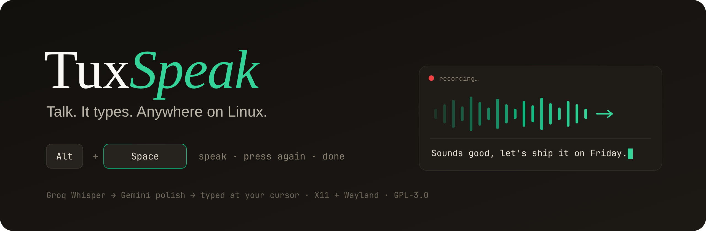
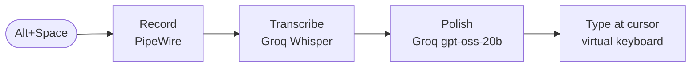

<p align="center">
  
</p>

<p align="center">
  
  
  <a href="LICENSE"></a>
  <a href="https://tuxspeak.barestack.org"></a>
</p>

<p align="center">
  <b>Press <kbd>Alt</kbd> + <kbd>Space</kbd>, say what you mean, press it again.</b><br>
  Clean, punctuated text appears wherever your cursor is: browser, terminal, IDE, Slack, email.<br>
  No extension, no app-specific plugin. It types like a keyboard.
</p>

<br>

## Install

```bash
git clone https://github.com/anirudhprashant/tuxspeak.git
cd tuxspeak && ./install-xhisper.sh
```

The installer handles dependencies (`pacman` on Arch and derivatives, `apt` on Debian and Ubuntu), asks for two free API keys, builds the typing daemon
and sets up permissions. **Reboot once** if it adds you to the `input` group, then bind
the shortcut ([below](#bind-altspace)).

You need Linux with PipeWire and two free keys, no card required:

| Key | Does | Get it |
|---|---|---|
| **Groq** | Speech to text (Whisper) | [console.groq.com/keys](https://console.groq.com/keys) |
| **Gemini** | Fallback for cleaning up the text if the Groq call fails (Gemini 3.1 Flash Lite) | [aistudio.google.com/apikey](https://aistudio.google.com/apikey) |

<details>
<summary><b>Let an AI agent install it for you</b></summary>

Paste this into Claude Code, Codex or any coding agent:

```
Install TuxSpeak on my Linux machine:
1. Clone https://github.com/anirudhprashant/tuxspeak.git and read its README.
2. Run ./install-xhisper.sh. It asks for my Groq and Gemini keys
   (free: console.groq.com/keys and aistudio.google.com/apikey).
3. Bind Alt+Space to xhisper-gemini for my desktop. On GNOME, free the key first:
   gsettings set org.gnome.desktop.wm.keybindings activate-window-menu "[]"
4. Start the daemon: nohup xhispertoold &>/dev/null &
5. Tell me to reboot if I was added to the input group, then to test Alt+Space.
```
</details>

## How it works



- **Silence cancels.** If nothing was said, nothing is typed.
- **Polish can't lose your words.** If the Groq polish fails it retries with Gemini, and if that fails too you get the raw transcript.
- **Stop with a tap of Alt.** Alt+Space starts recording, then tap Alt on its own (or press Alt+Space again) to stop.
- **Or hold Alt to talk.** Hold Alt for a quarter of a second to record, let go to stop (Hyprland setup below). Clips under about 0.6s are discarded. The `(recording...)` marker shows in hold mode too.
- **Status stays in the text box.** A `(recording...)` marker shows while recording and is removed when you stop. No notifications.
- **Every dictation is saved**, raw and polished, with a timestamp.
- **Long recordings** switch automatically to the larger Whisper model.

`xhispertool` creates a virtual keyboard through `/dev/uinput`, so ASCII is typed as real
kernel key events. Unicode and emoji go through the clipboard and a simulated
<kbd>Ctrl</kbd>+<kbd>V</kbd>. That's why it works in any app, with no accessibility APIs
and no compositor integration.

## Bind Alt+Space

**GNOME**: free the key, then add a custom shortcut:

```bash
gsettings set org.gnome.desktop.wm.keybindings activate-window-menu "[]"
# Settings → Keyboard → Custom Shortcuts → +
#   Name: TuxSpeak   Command: ~/.local/bin/xhisper-gemini   Shortcut: Alt+Space
```

**KDE**: System Settings → Shortcuts → Custom Shortcuts → New → Global Shortcut → Command, then `~/.local/bin/xhisper-gemini` on <kbd>Alt</kbd>+<kbd>Space</kbd>.

**Hyprland · Sway · i3**: bind `xhisper-gemini` to Alt+Space in your config, e.g. `bind = ALT, SPACE, exec, xhisper-gemini`.

To stop with a lone Alt tap on Hyprland, also bind `xhisper-stop` on Alt release (Hyprland doesn't fire it for the Alt released after the Alt+Space chord, so a tap is always a real stop):

```
bindr = ALT, Alt_L, exec, xhisper-stop
bindr = ALT, Alt_R, exec, xhisper-stop
```

For hold-Alt-to-talk, also bind `xhisper-ptt` on a bare Alt press. It waits 0.25s, so Alt+Space and quick taps don't start a recording. Holding Alt for other shortcuts longer than that can start one, and it keeps running until your next lone Alt tap:

```
bind = , Alt_L, exec, xhisper-ptt
bind = , Alt_R, exec, xhisper-ptt
```

## Commands

| Command | Does |
|---|---|
| `xhisper-gemini` | Record, transcribe, polish, type (what Alt+Space runs) |
| `xhisper-gui` | Popup with the last dictation, Copy and History buttons |
| `xhisper-ptt` | Hold-to-talk: start recording while Alt is held (bind to a bare Alt press) |
| `xhisper-stop` | Stop an active recording (bind to a lone Alt release) |
| `xhisper-last` | Print the last polished dictation |
| `xhisper-history` | Print the full history |

History lives in `~/.local/share/xhisper/history.txt`. Keys live in `~/.env`.

> [!NOTE]
> `xhisper-gui` places itself for a 1920×1080 screen. On other resolutions, edit `X_POS` and `Y_POS` in `~/.local/bin/xhisper-gui`.

On Hyprland the popup would be tiled, so add a rule to float it small in the bottom-right corner (this also fixes the placement on any resolution). In `hyprland.conf`:

```
windowrule = float, class:^(xhisper)$
windowrule = size 340 280, class:^(xhisper)$, title:^(xhisper)$
windowrule = size 380 400, class:^(xhisper)$, title:^(xhisper History)$
windowrule = move (monitor_w-w-20) (monitor_h-h-60), class:^(xhisper)$
```

## Configure

```bash
cp /usr/local/share/xhisper/default_xhisperrc ~/.config/xhisper/xhisperrc
```

| Setting | Default | Meaning |
|---|---|---|
| `long-recording-threshold` | `1000` | Seconds before switching to the larger Whisper model |
| `silence-threshold` | `-50` | dB level counted as silence |
| `silence-percentage` | `95` | % of silent audio that cancels the dictation |
| `non-ascii-initial-delay` | `0.15` | Seconds before the first Unicode paste |
| `non-ascii-default-delay` | `0.025` | Seconds between Unicode pastes |

## Troubleshooting

| Symptom | Fix |
|---|---|
| `xhispertool not found` | `cd xhisper-src && sudo make install` |
| Nothing happens | Start the daemon: `xhispertoold &` |
| `uinput permission denied` | Reboot, or `sudo usermod -aG input $USER` and log in again |
| Recording but no text | Check the Groq key in `~/.env`, then read `/tmp/xhisper-gemini.log` |
| Text not polished | Check the Groq and Gemini keys. Raw text is typed as a fallback |
| Unicode doesn't paste | Install `wl-clipboard` (Wayland) or `xclip` (X11) |

## Privacy

Audio is recorded locally and sent only to Groq for transcription. Only the resulting text
goes to Gemini. Nothing else leaves your machine, and there is no TuxSpeak server.

## Credits and licence

Built on [**xhisper**](https://github.com/imaginalnika/xhisper) by Nika, the C daemon and
original dictation tool (MIT). TuxSpeak adds the AI polishing pipeline, history, GUI and
installer, licensed **GPL 3.0**. The `xhisper-src/` core stays MIT. See [LICENSE](LICENSE).

---

<p align="center"><sub>made by <a href="https://github.com/anirudhprashant">Anirudh Prashant</a> · <a href="https://tuxspeak.barestack.org">tuxspeak.barestack.org</a></sub></p>
